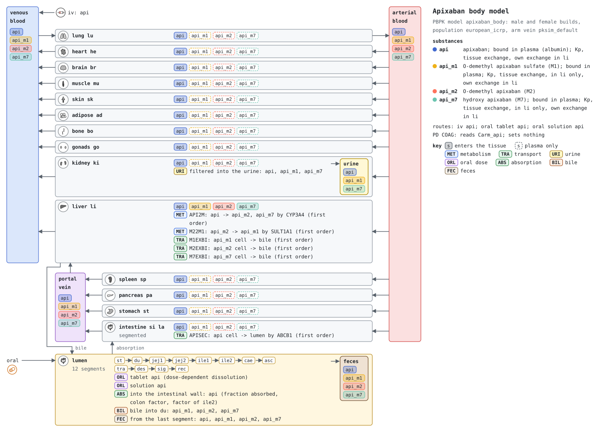
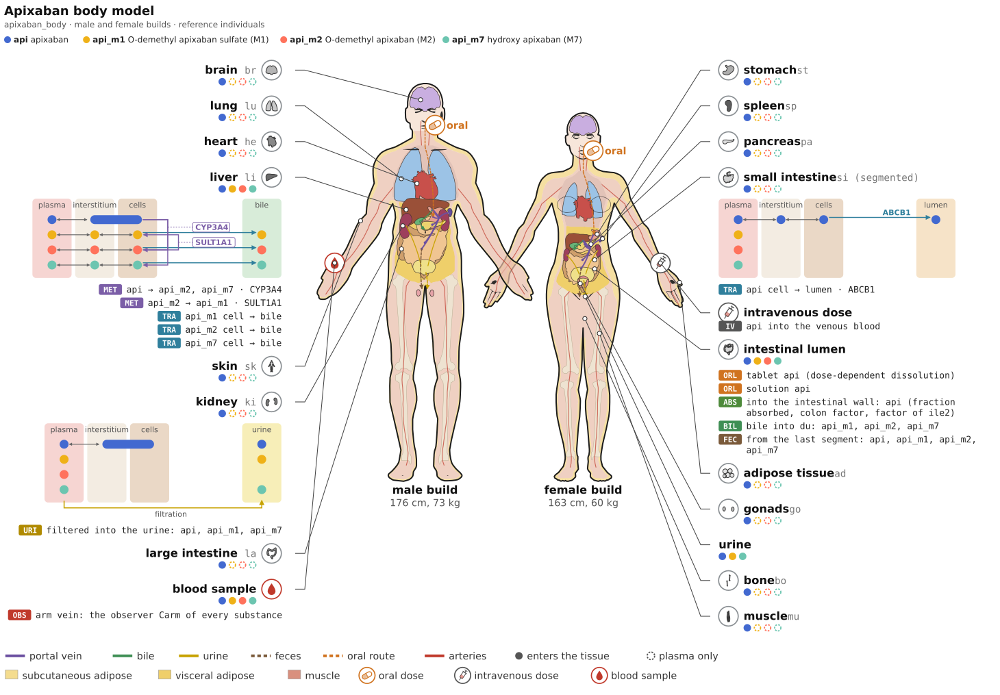

[](https://doi.org/10.5281/zenodo.18877904)
[](https://github.com/matthiaskoenig/apixaban-model/releases)
[](https://matthiaskoenig.github.io/apixaban-model/)
[](https://github.com/matthiaskoenig/apixaban-model/actions/workflows/ci.yml)
[](https://hub.docker.com/r/matthiaskoenig/apixaban)
[](https://www.python.org)
[](https://opensource.org/license/MIT)
[](https://creativecommons.org/licenses/by-sa/4.0/)

# Physiologically based pharmacokinetic/pharmacodynamic (PBPK/PD) model of apixaban

This repository provides the apixaban physiologically based pharmacokinetic/pharmacodynamic (PBPK/PD) model: the absorption, the hepatic metabolism by CYP3A4, the renal excretion and the intestinal secretion of apixaban, its metabolites and the anticoagulant effects (anti-factor Xa activity, INR, PT, aPTT).

Documentation: <https://matthiaskoenig.github.io/apixaban-model/>

Credibility of the model for its contexts of use: [https://matthiaskoenig.github.io/apixaban-model/credibility.html](https://matthiaskoenig.github.io/apixaban-model/credibility.html)

## Model





## Quick start

```bash
git clone https://github.com/matthiaskoenig/apixaban-model.git && cd apixaban-model
uv sync
uv run python -m sbmlsim.run simulate specs/simulate.json --out results/simulate
```

## How to cite

> Myshkina, M., Chang, L., Metternich, J., Badon, S., Babaeva, M., Elias, M. & König, M. (2026). *Physiologically based pharmacokinetic/pharmacodynamic (PBPK/PD) model of apixaban*. Zenodo. https://doi.org/10.5281/zenodo.18877904

## License

* Source Code: [MIT](https://opensource.org/license/MIT)
* Documentation: [CC BY-SA 4.0](https://creativecommons.org/licenses/by-sa/4.0/)
* Models: [CC BY-SA 4.0](https://creativecommons.org/licenses/by-sa/4.0/)

&copy; 2025-2026 Mariia Myshkina, Linh Chang, Johannes Metternich, Shelee Badon, Mariia Babaeva, Michelle Elias and Matthias König
