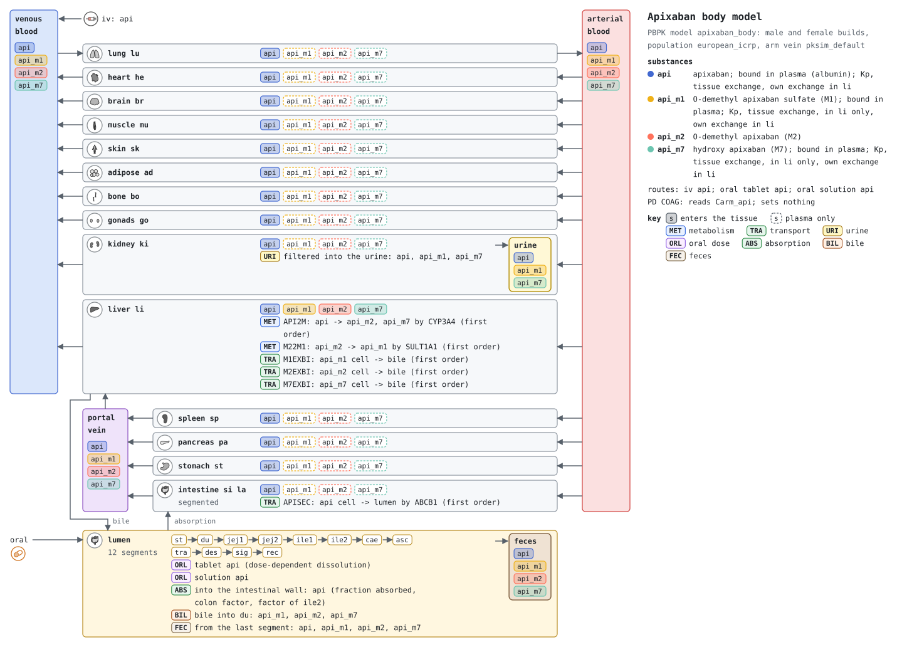
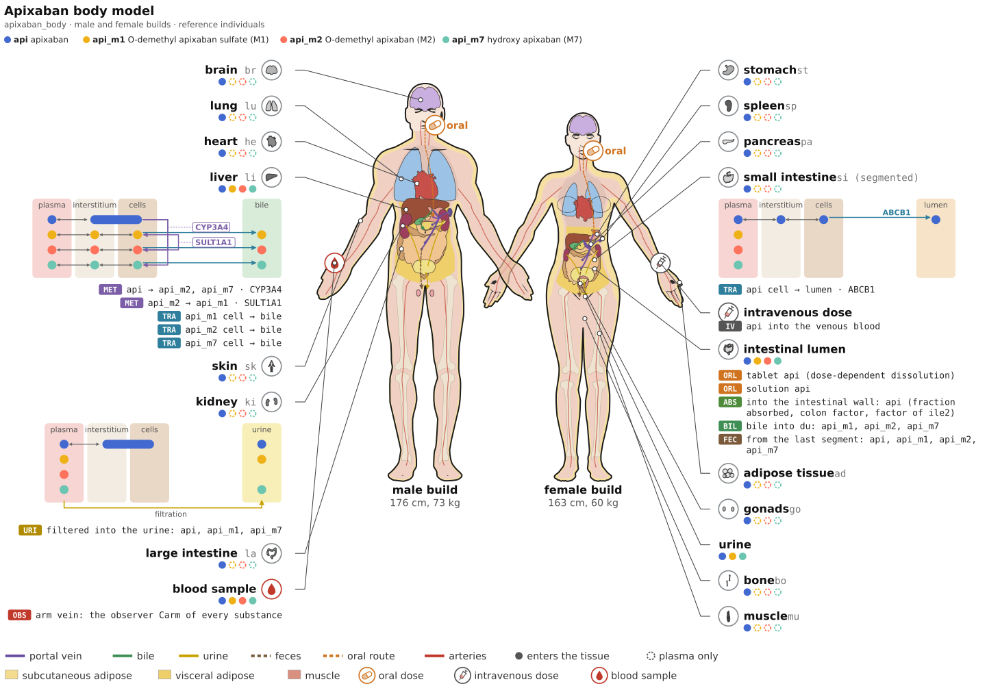

# Models

The models are distributed in [SBML](http://sbml.org) format.

## apixaban_body

* Model: [`apixaban_body.xml`](https://raw.githubusercontent.com/matthiaskoenig/apixaban-model/main/models/apixaban_body.xml)
* Report: [SBML4humans](https://sbml4humans.de/report?url=https%3A%2F%2Fraw.githubusercontent.com%2Fmatthiaskoenig%2Fapixaban-model%2Fmain%2Fmodels%2Fapixaban_body.xml)

{ style="width: 100%" }

{ style="width: 100%" }

## apixaban_body_female

* Model: [`apixaban_body_female.xml`](https://raw.githubusercontent.com/matthiaskoenig/apixaban-model/main/models/apixaban_body_female.xml)
* Report: [SBML4humans](https://sbml4humans.de/report?url=https%3A%2F%2Fraw.githubusercontent.com%2Fmatthiaskoenig%2Fapixaban-model%2Fmain%2Fmodels%2Fapixaban_body_female.xml)

## apixaban_body_female_flat

* Model: [`apixaban_body_female_flat.xml`](https://raw.githubusercontent.com/matthiaskoenig/apixaban-model/main/models/apixaban_body_female_flat.xml)
* Equations: [`apixaban_body_female_flat.md`](https://github.com/matthiaskoenig/apixaban-model/blob/main/models/apixaban_body_female_flat.md)
* Report: [SBML4humans](https://sbml4humans.de/report?url=https%3A%2F%2Fraw.githubusercontent.com%2Fmatthiaskoenig%2Fapixaban-model%2Fmain%2Fmodels%2Fapixaban_body_female_flat.xml)

## apixaban_body_flat

* Model: [`apixaban_body_flat.xml`](https://raw.githubusercontent.com/matthiaskoenig/apixaban-model/main/models/apixaban_body_flat.xml)
* Equations: [`apixaban_body_flat.md`](https://github.com/matthiaskoenig/apixaban-model/blob/main/models/apixaban_body_flat.md)
* Report: [SBML4humans](https://sbml4humans.de/report?url=https%3A%2F%2Fraw.githubusercontent.com%2Fmatthiaskoenig%2Fapixaban-model%2Fmain%2Fmodels%2Fapixaban_body_flat.xml)

## COMBINE archive

The models and the metadata are available as COMBINE archive from [`apixaban_model.omex`](https://raw.githubusercontent.com/matthiaskoenig/apixaban-model/main/apixaban_model.omex).
